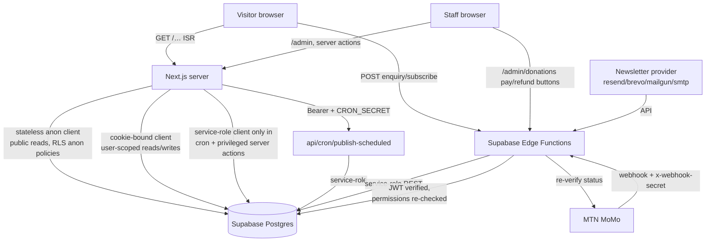

# Architecture

Describes the system as it exists in this repository (verified 2026-11-09
against commit `5f41b3a`). Not the intended future state: see
[ROADMAP.md](../ROADMAP.md) for that, and [STATUS.md](../STATUS.md) for what
works today.

## What this is

One Next.js 16.4.4 application with three surfaces, one Supabase backend:

1. The public website (`/`) — ISR-cached content pages rendered from Supabase.
2. The staff administration panel (`/admin`) — cookie-session-driven admin UI.
3. Supabase Edge Functions (Deno) — the only code that holds the service-role
   key and touches privileged tables and providers.

Where code lives:

```
src/
├── app/
│   ├── (public)/       # public website; revalidate = 300 (ISR)
│   ├── (auth)/         # /login, standalone layout
│   ├── admin/          # 20 admin modules + [module] scaffold fallback
│   ├── api/            # health, donations/[id], cron/publish-scheduled
│   ├── auth/callback/  # Supabase PKCE callback
│   └── manifest.ts     # PWA manifest
├── components/{ui,public,admin,shared}
├── features/           # one folder per domain: queries.ts, actions.ts, helpers
├── lib/
│   ├── supabase/       # browser, server (cookie-bound), public (stateless), admin, service-role
│   ├── auth/           # session resolution + route guards
│   ├── permissions/    # permission catalogue, can() checks, admin module map
│   ├── validation/     # Zod schemas shared by client and server
│   ├── security/       # rate limiting, timing-safe helpers
│   └── env.ts          # zod-validated env access; nothing parsed at module scope
├── types/database.ts   # re-exports generated types (never hand-edited)
└── proxy.ts            # Next 16 middleware: session refresh, admin gate, nonce CSP

supabase/
├── migrations/         # 18 ordered SQL migrations (incl. donation refund RLS fixes)
├── functions/          # 13 Deno Edge Functions + _shared modules + provider adapters
├── seed.sql            # dummy seed content
├── tests/rls_smoke_tests.sql   # manual RLS verification (not automated)
└── config.toml         # local stack config; safeguarding schema NOT exposed
```

## Components and data flow



Key relationships:

- **Public reads never touch user context.** `src/app/(public)/**` pages use a
  stateless anonymous client (`src/lib/supabase/public.ts`, no cookies) so pages
  stay ISR-cacheable `revalidate = 300`. Access to published rows is governed by
  anon RLS policies on `public.*` tables.
- **User-scoped reads/writes use the cookie-bound server client** (`src/lib/supabase/server.ts`).
  RLS sees the real caller. Admin pages resolve permissions from
  `user_roles → role_permissions → permissions` per request (`src/lib/auth/session.ts`,
  memoised with React `cache()`), honouring expired grants and inactive profiles.
- **Mutations are Server Actions** in each feature's `actions.ts`, guarded by
  `assertPermission(...)`. There is no hand-written REST layer; exceptions are
  `/api/health`, `/api/cron/publish-scheduled`, `/api/donations/[donationId]`
  and `/auth/callback`.
- **The service-role client exists server-side only** (`src/lib/supabase/admin.ts`)
  and refuses to run in a browser. It backs the cron route and privileged actions.

## Trust boundaries

| Boundary | What is on each side | Enforcement |
|---|---|---|
| Browser ↔ Next.js | Untrusted input; rendered pages | Zod validation server-side (clients revalidate twice: RHF+Zod then Zod in the action), server-only env vars, CSP nonce injected per request in `src/proxy.ts` |
| Next.js ↔ Postgres (anon) | Published content only | RLS policies; anonymous policies require published/approved rows |
| Next.js ↔ Postgres (authenticated) | Session-scoped rows | RLS keyed on `auth.uid()` + permission tables |
| Next.js ↔ Edge Functions | Bearer JWT + permission | Each privileged function re-verifies the JWT against Supabase Auth and re-resolves permissions from the DB (`supabase/functions/_shared/caller.ts`), mirroring `app_private.has_permission()`, including `profiles.is_active` and `user_roles.expires_at` |
| Provider ↔ Edge Functions | Untrusted webhook payloads | `payment-webhook` calls `x-webhook-secret` with timing-safe comparison, then re-queries the provider for the real status (`_shared/momo.ts checkStatus`) — it never trusts the payload |
| Cron caller ↔ Next.js | `CRON_SECRET` bearer | Fails closed with 503 when unset; rate-limited 30/h/IP |

The `safeguarding` schema is deliberately excluded from the exposed API schemas
(`supabase/config.toml`) and grants nothing to `anon`/`authenticated`. The only
route to safeguarding data is Edge Functions with the service-role key,
requirement checks (`safeguarding.access`, lead-only features gated by
`safeguarding.lead`), access logging into `safeguarding.case_access_events`,
and AES-256-GCM encryption of case notes with `SAFEGUARDING_ENCRYPTION_KEY`.
No client code path exists to that schema.

## Data model summary

Full details live in `supabase/README.md` and the migrations. Highlights:

- Identity/RBAC: `profiles`, `roles`, `permissions`, `role_permissions`, `user_roles` (with `expires_at`).
- CMS: `pages`, `page_translations`, `page_sections`, `site_settings`, `navigation_*`.
- Editorial: `content_items` (with `status`: draft/review/scheduled/published),
  `content_revisions` (immutable snapshots), `content_approvals`, `categories`, `tags`, `content_taxonomies`.
- Programmes/partners: `programmes(+ translations)`, `partners(+ translations)`.
- Impact: `impact_metrics` — English-only, approval-gated public figures.
- Media: `media_assets`, `media_usage` + Storage bucket `public-media`.
- Enquiries: `general_enquiries`, `enquiry_notes`. Public insert path is
  deliberately narrow (status fixed to `new`, requires `consent_to_contact`).
- Finance: `donation_campaigns`, `donations`, `payment_events`, `donation_refunds`, `finance_reconciliations` — multi-currency by explicit code (XAF usage by convention).
- Newsletter: `newsletter_subscribers`, `newsletter_consents`, `newsletter_campaigns`, `newsletter_events`.
- Kids' Corner: `kids_resources(+ translations)` with safeguarding approval.
- Private: `safeguarding.*` (cases, subjects, intake details, encrypted notes, attachments, access events, consents).
- Compliance: `audit_events` (append-only; trigger-maintained).

## Design decisions visible in the code

These are choices realized by the current structure:

- **One codebase, two surfaces** — `(public)` and `admin` route groups share
  tokens, DB and clients, never a layout. Chosen so a small team maintains a
  single deployment; the split is enforced by route groups, guards and RLS.
- **Permissions from the database, not the token** — JWTs can be replayed/stale;
  DB permissions reflect revoked/expired/inactive state immediately. Server and
  Edge Function paths both re-check rather than trusting claims.
- **Safeguarding as a private schema + Edge Functions** — keeps the most
  sensitive data outside the API surface where RLS policies on shared tables
  might leave a hole. UI fails closed while functions are not deployed.
- **Server-first data access** — reads in Server Components, writes in Server
  Actions; keeps cross-surface logic type-checked in one place.
- **Env access deferred to point of use** — `src/lib/env.ts` parses nothing at
  module scope, so a missing variable never crashes `next build`; a feature
  fails loudly instead, or the UI communicates that it is unavailable.
- **Type generation over hand-written ORM models** — `npm run db:types` writes
  `src/types/database.gen.ts` from the live schema; `src/types/database.ts` only
  re-exports it.

Where the reasoning was not recorded in the repo, no reason is given here
rather than an invented one: for example, the exact choice of MTN MoMo as the
mobile-money provider and the pooler-region default `aws-0-eu-west-1` are
implementation facts carried forward from the hosting effort, not documented
decisions.
